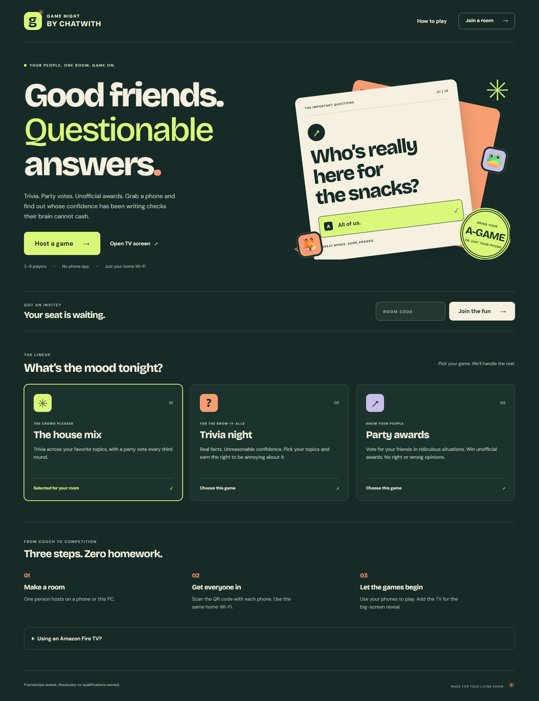
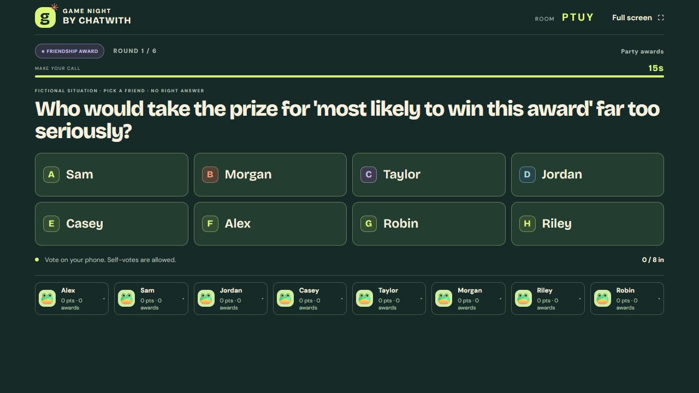

# Game Night by ChatWith

**Your TV is the game board. Your phones are the controllers.**

A free, open-source party game for 2–8 people in the same home. Run it on one computer, open the TV display in a browser, and let everyone join with a QR code. The host can play too.



## What you can play

| Mode             | How it works                                                                                                           |
| ---------------- | ---------------------------------------------------------------------------------------------------------------------- |
| **House mix**    | Trivia with a party vote every third round. Facts earn points; opinions give awards.                                   |
| **Trivia night** | Pick your topics. Each correct answer earns 1,000 points.                                                              |
| **Party awards** | Vote for friends in absurd situations and answer group polls. No right answers, no trivia points. Ties share an award. |

There are **268 local prompts**: 200 trivia questions, 44 party awards, and 24 group polls. Topics include general knowledge, movies, music, science, sports, Fortnite, history, world knowledge, food, and After Hours. Some party jokes mention bars and hangovers. No drinking is needed.

Choose 6, 10, or 16 rounds and a 15-, 25-, or 40-second timer. Pause for snacks, show the reveal, or let rounds move on by themselves. New games in the same room prefer prompts you have not seen yet.

## Start a game

You need one Windows, macOS, or Linux computer, [Node.js 24](https://nodejs.org/), and a home network that connects the computer, phones, and TV. Node.js 22.12 or newer also meets the minimum requirement. Initial setup needs internet access. After setup, the game works offline on your home network.

### Download and play

1. Download `game-night-0.1.0.zip` from [Releases](https://github.com/ChatWith-Technologies/game-night/releases/latest). Extract the whole ZIP to a folder.
2. On Windows, open **Start Game Night.cmd**. On macOS or Linux, open a terminal in the folder and run `node scripts/play.mjs`.
3. Keep the game window open. It prints the computer, phone, and TV addresses. Open the computer address in a browser to get started.

The launcher installs the needed packages on its first run. It does not ask for an account or API key. The release includes the built game screens. Press **Ctrl+C** in the game window to stop the server.

### Run from source

Download this repository with **Code → Download ZIP**, extract it, and open a terminal in that folder:

```sh
npm ci
npm run build
npm start
```

Or use `node scripts/play.mjs` to run the first setup and start in one step. If you edit the screens later, run `npm run build` again.

## Connect phones and a TV

1. Open the **Phones** address printed by the server on the host's phone. Use the same Wi-Fi as the computer.
2. Tap **Host a game**. Choose the settings, then tap **Join & play** and enter your name. This phone now has answer buttons and host controls.
3. Open the printed **TV** address in the TV's browser. Enter the four-letter code from the host's phone. You can also open **Open the TV view** on a computer connected to the TV with HDMI.
4. Other players scan the QR code on the TV or open the phone address and enter the room code. Each player chooses a name and an avatar.
5. When at least two people are ready, the host taps **Let's play**. Everyone answers on their own phone. The TV shows questions, totals, and results without taking a player seat.

The room code works **on your own running server**. It is not a code for a central website. Use the complete `http://` address printed by your computer; `localhost` on a phone refers to that phone, not the computer.



Example display. Use the room code and address from your own running game.

### Amazon Fire TV / Fire TV Stick / Fire TV Cube

Open **Amazon Silk** on the Fire TV. Type the printed TV address, then enter the room code. A typical address looks like `http://192.168.1.50:3210/tv`, but use the address from your own server. You can say “Alexa, open Amazon Silk” to open the browser. [Amazon's Silk guide](https://docs.aws.amazon.com/silk/latest/developerguide/what-is-silk.html) explains browser support.

The remote is only needed to open the page and enter the code. The host's phone controls the game. Game Night does not pair with or take remote control of your TV.

Any TV browser that can run the game page may work. If your TV has no suitable browser, connect a computer with HDMI or mirror a browser window. A TV is optional; the whole game can also run on phones.

## If something does not connect

| Problem                           | What to do                                                                                                                     |
| --------------------------------- | ------------------------------------------------------------------------------------------------------------------------------ |
| Phone cannot open the page        | Keep the computer awake. Use the same home network, not an isolated guest network. Enter the full `http://` address.           |
| Windows asks about network access | Allow Node.js on your **private home network**. Do not turn off the firewall.                                                  |
| QR code shows the wrong address   | Copy `.env.example` to `.env`, set `GAME_LAN_IP` to the computer's home-network IPv4 address, and restart.                     |
| Port is already in use            | Stop the other server, or set `PORT=3220` in `.env`. Use the new printed address. The launcher does not stop other programs.   |
| Player reloads a page             | Use the same browser and address. Your seat and locked answer should return while the room exists.                             |
| Host has no answer buttons        | Tap **Join & play** before starting. A TV page is a display, not a player.                                                     |
| Room is gone                      | Rooms are held in memory. Create a new room after restarting the server or after six hours of inactivity.                      |
| TV content looks clipped          | Set browser zoom to its normal value and check the TV's picture size or overscan setting. The TV layout is tested at 1280×720. |

Host controls are saved in the browser that made the room. Keep that page open. Use **Open the TV view** for a shared screen, so host controls remain on the host's device.

## Privacy and scope

Game Night runs on your home network. It has no accounts, ads, analytics, paid API, or required AI service. Questions, fonts, and QR codes are served by your own computer. Individual answers stay private from other players; the reveal shows the correct trivia answer or total votes.

Names, rooms, scores, and votes are held in server memory. A restart clears them. The browser stores only the details needed to reconnect. Anyone who knows the room code and can reach your server can view that room. Use a trusted network. Do not publish the server through port forwarding or an internet tunnel. Read [SECURITY.md](SECURITY.md) for the limits.

This is a browser game hosted by a computer. It is not an app installed on the TV, and this repository does not provide a hosted public game service. All player names are entered by the people playing. There is no fixed friend list or personal profile data.

## Build, test, and contribute

Built with Node.js, React, and Socket.IO. See [CONTRIBUTING.md](CONTRIBUTING.md) for the file map, content rules, and browser tests.

```sh
npm run check
```

The test suite covers scoring, private answers, host rights, two-to-eight-player limits, timers, reconnects, rematches, and real browser games in Chromium and WebKit. Browser tests emulate mobile screens and a 720p TV; they do not certify every physical phone or TV.

MIT licensed. You can use, change, share, and host your own copy under [LICENSE](LICENSE). Fonts and dependencies retain their own licenses; see [THIRD_PARTY_NOTICES.md](THIRD_PARTY_NOTICES.md).
